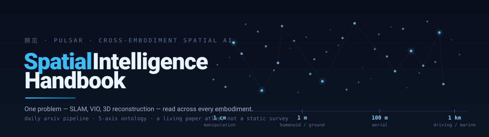

 

**A cross-embodiment spatial-AI handbook.**
SLAM, VIO, 3D reconstruction, sensor stacks and deployment traps — read side by side across
manipulation · aerial · driving · marine, on one shared 3DGS / VGGT / depth-foundation layer.

---

从厘米到公里、从地下到空中,桌面机械臂、无人机、自动驾驶、水下机器人都把物理空间变成可推理的表示。但
manipulation 圈的 SLAM 综述里没有 outdoor,AD 圈的 BEV 综述里没有 manipulation,drone 圈和水下圈几乎不读
对方的论文。**这本 handbook 聚焦同一类空间问题在不同 embodiment 下的表示、传感器与部署取舍。**

## Why this exists

- **跨 embodiment 对照.** 把 manipulation / driving / aerial / marine 的同类问题放在 `crossing/` 比较，并明确条件和边界。
- **工程导向.** 深度文章按模板整理表示选型、关键超参、shape sanity-check 与部署陷阱；未复现或未验证的数字以正文标注为准。
- **持续维护.** 固定管线采集、评级并核查论文，精选后写入日档或深度文章；来源日期、版本和历史补录分别记录。生成沿用现有 DeepSeek。

## 2026-10-18 内容更新

- [历史论文补录](./reports/spatial-daily/2026-10-18.md)：补回 2026-10-04—10-17 来源日期范围内的 317 篇收录，补录时间与论文日期分开标记，不并入当周新增趋势。
- [CBF-guided diffusion 安全轨迹规划](./embodiments/aerial/obstacle-avoidance/safer_trajectory_planning_with_cbf_guided_diffusio_dissection.md)：本篇仅覆盖已核查的 v1，不将后续版本的结果混入。
- [报告归档](./reports/README.md) 与各目录 README 提供 GitHub 导航；根入口以本仓为准。

> 统计快照：2026-10-20。`foundations/` 为 153 篇（排除 README、overview 与 github_failure_atlas）；全仓有 133 个 `*_dissection.md` 文件。Atlas 的 3,665 条记录是坐标源条目数，包含不同评级，不等于精选深度文章数。

## 持续更新与本地检索

正文以 GitHub 本仓为入口，按各目录 README 浏览或使用仓库搜索。维护服务器另提供 Spatial 与 VLA 的永久正文检索，每小时 07、22、37、52 分核对 GitHub 已发布版本；草稿不进入已发布正文索引。原有近 60 日情报检索继续保留，文件路径与版本引用用于回查来源。

| 工作 | 计划触发时间（北京时间） | 阅读或验收入口 |
|---|---|---|
| 服务器 RSS / 评分 / 热点 / SOTA | 每日 08:00 / 08:35 / 09:00 / 10:00 | [每日归档](./reports/spatial-daily/) · [Atlas](./reports/atlas/overview.md) |
| GitHub 每日精选 / 深度解析 | 工作日 08:30 / 每日 14:00 | [Actions](https://github.com/sou350121/Spatial-Intelligence-Handbook/actions) · [报告目录](./reports/README.md) |
| GitHub 周度侦察 | 每周五 10:00 | [周报归档](./reports/weekly/) |
| 已发布版本与本地全文索引 | 每小时 07、22、37、52 分 | 维护服务器的独立全文检索入口；索引不调用模型 API |
| 共享服务器巡检 / 运维快照 | 巡检每小时 07、22、37、52 分及每日 18:45；快照每周日 06:05 | GitHub Issues 故障通知；快照后立即隔离还原核验 |

时间表示计划触发，不保证届时已有新文章。生成与核验沿用现有 DeepSeek；来源不足、版本不明或质量检查未通过时保留失败状态，不降低门槛。服务器沿用有界漏跑补救，不需要电脑或 Codex 常开，不使用 Telegram。运维快照保留在同一台服务器，尚不属于异地备份。计划核对日期：2026-10-20。

## The Atlas — a map, not a list

[**`reports/atlas/overview.md`**](./reports/atlas/overview.md) · 机器可读源 [`atlas.jsonl`](./reports/atlas/atlas.jsonl)

Atlas 按 problem / representation / sensor / paradigm / time 五轴组织论文记录。完整坐标和评级以 JSONL 为准；按时间比较时，应区分来源日期、历史补录及未标注项，不能把静态示意图当实时趋势。

当前快照有 **3,665 条记录**；阅读入口见上方 overview。实际方法取舍仍需回到对应文章、论文与实验条件。

## Where to start

**30 分钟建立框架** — 按依赖顺序,每篇回答上一篇读完后自然产生的问题:

1. [**3DGS family**](./foundations/3dgs-family/) `5 min` — 比较 3DGS 与 NeRF 的表示、重建和部署取舍。
2. [**VGGT — feed-forward 3D 的范式转移**](./foundations/feed-forward-3d/) `10 min` — 了解前馈几何路线如何与重建、SLAM 及空间表示配合。
3. [**VGGT 能替代 drone VIO 吗?**](./crossing/slam-vio-migration/vggt_vs_drone_vio.md) `10 min` — **本书代表作**。同一个问题在 manipulation / aerial / marine 上的答案完全不同:Jetson Orin 上 100ms 够不够、scale ambiguity 怎么和 IMU/GNSS 融合、比 VINS-Mono 强在哪、坑在哪。
4. [**sensor budget matrix**](./crossing/sensor-stack-matrix/) `5 min` — 一张矩阵看懂为何 manipulation 不用 LiDAR、drone 不用 RGBD、水下不用 RGB。

**或者按角色选入口:**

| 你是 | 起点 |
|---|---|
| 跨 embodiment 转岗的算法工程师 | [`crossing/slam-vio-migration/`](./crossing/slam-vio-migration/vggt_vs_drone_vio.md) — 同源问题在不同 embodiment 的解空间为何差这么大 |
| 找下一个 paper idea 的研究者 | [`crossing/failure-modes-atlas/`](./crossing/failure-modes-atlas/) — 跨 embodiment failure mode 对比图就是 idea 来源 |
| 传感器 / 硬件团队 | [`foundations/sensor-physics/`](./foundations/sensor-physics/) `★ 独家轴` — 学界综述写不出的 SWaP-C 工程账 |
| 无人机 / aerial autonomy | [`embodiments/aerial/`](./embodiments/aerial/) — 维护者深度锚点,其他 embodiment 的 1.5–2× 深度 |
| 补 SE(3) / BA / 3D 数学基础 | [`foundations/spatial-math/`](./foundations/spatial-math/) — 所有 SLAM/VIO 的数学骨架 |
| 从 VLA 侧来,想接 3D 表示 | [`bridge-to-vla/`](./bridge-to-vla/) — feature cloud → action head 的两端契约 |

> 完整 6 场景分流见 [`ONBOARDING.md`](./ONBOARDING.md)。按 GitHub 各目录 README 浏览，或用仓库文件搜索定位主题。

## Repository map

九个内容目录 —— `foundations/` 是所有 embodiment 共用的工具箱,`crossing/` 是本书不可替代的 USP,`embodiments/`
是应用层,其余是支撑层。

<b><code>foundations/</code></b> — 跨 embodiment 共享底层 · <code>13 zones · 170 篇</code>

3DGS / VGGT / Depth Foundation / 经典 SLAM 这些原语 —— 无论做 manipulation、aerial 还是 marine 最终都回到这里。学界按 "方法" 切,本书把所有 embodiment 共用的底层收齐一份,让上层不必重复造轮子。

| 入口 | 说明 |
|---|---|
| [`feed-forward-3d/`](./foundations/feed-forward-3d/) | VGGT 解构 — CVPR 2025 best,范式转移信号 |
| [`3dgs-family/`](./foundations/3dgs-family/) | 3DGS 与 NeRF 的表示及部署取舍 |
| [`depth-foundation/`](./foundations/depth-foundation/) | Depth Anything v2 — 相对 vs 度量深度的现场 trap |
| [`sensor-physics/`](./foundations/sensor-physics/) | `★` 独家轴 — 学界写不出的 SWaP-C 物理 |
| [`spatial-math/`](./foundations/spatial-math/) | SE(3) / BA / IMU preintegration 数学骨架 |

<b><code>crossing/</code></b> `★ USP` — 跨 embodiment 合流 · <code>5 wedges</code>

把各 embodiment 的同类问题按适用条件横向对比。写入门槛极高:必须跨 ≥3 embodiment、每 embodiment 附论文来源、至少 1 个工程数字、文末必须有 Boundary 段。

| wedge | 一句话 |
|---|---|
| [`slam-vio-migration/`](./crossing/slam-vio-migration/vggt_vs_drone_vio.md) `★` | 桌面 → 户外 → 空中 → 水下 同源问题不同解 |
| [`sensor-stack-matrix/`](./crossing/sensor-stack-matrix/) | 各 embodiment 用什么 sensor、为什么、SWaP-C 对比 |
| [`scale-comparison/`](./crossing/scale-comparison/) | 1cm → 1000km,同一问题在不同尺度怎么变形 |
| [`representation-migration/`](./crossing/representation-migration/) | 3DGS / VGGT 在各 embodiment 的部署对比 |
| [`failure-modes-atlas/`](./crossing/failure-modes-atlas/) | 不同 embodiment 的空间失败方式总图 |

<b><code>embodiments/</code></b> — 各 embodiment 应用层 · <code>6 lanes · aerial 深度锚点</code>

同一类空间问题在不同 embodiment 上 scale / sensor / dynamics / failure mode 截然不同。`manipulation` · `humanoid-legged` · `ground-mobile` · `driving` · **`aerial` ★**(维护者深度锚点)· `marine`(视觉退化 contrasting case)。AR/VR 作为 `crossing/` 对比案例提及,不独立成 embodiment。

<b>支撑目录</b> — bridge-to-vla · benchmarks · companies · deployment · cheat-sheet · reports

| 目录 | 内容 |
|---|---|
| [`bridge-to-vla/`](./bridge-to-vla/) | 3D 表示怎么接到 [VLA-Handbook](https://github.com/sou350121/VLA-Handbook) 的 action policy(两端契约) |
| [`benchmarks/`](./benchmarks/) | ScanNet++ / EuRoC / nuScenes / AQUALOC — 拆 *条件 + 失败模式 + 真机 gap*,不只是 leaderboard |
| [`companies/`](./companies/) | World Labs / Cosmos / Skydio / Wayve / Tesla — 谁的 stack 值得抄 |
| [`deployment/`](./deployment/) | hardware-selection · 多模态同步 · calibration · compute-budget · failure-modes |
| [`cheat-sheet/`](./cheat-sheet/) | timeline · representation 速查 · sensor budget matrix · [ontology v3.2](./cheat-sheet/ontology.md) |
| [`reports/`](./reports/) | 每日 Atlas + 每周前瞻侦察 + 每两周回顾(带预测得分卡)· Pulsar 自动产出 |

## 照见 trilogy — 三册一体

「照见」是三本独立但互引的 handbook,同一条 paper 在不同册读出的结论不一样。本仓是 **perception 端**。

| 册 | 角色 | 管什么 | 仓库 |
|---|---|---|---|
| VLA-Handbook | **action** | action policy(diffusion / flow / RL) | [github](https://github.com/sou350121/VLA-Handbook) |
| **Spatial-Handbook** *(本仓)* | **perception** | world representation(3DGS / VGGT / depth / sensor 物理) | [github](https://github.com/sou350121/Spatial-Intelligence-Handbook) |
| Physics-Gen-Handbook | **generation** | 物理可控生成(video WM / diff-sim / neural surrogate) | [github](https://github.com/sou350121/Physics-Controllable-Generation-Handbook) |

穿越时走对应 `bridge-to-*` 目录 —— 与 VLA 的接口见 [`bridge-to-vla/`](./bridge-to-vla/);边界划分详见 [`bridge-to-vla/overview.md`](./bridge-to-vla/).

## Contributing

CC BY 4.0 · 欢迎 Issue / PR:补论文解读 · 真机经验 · sensor 选型实测 · 跨 embodiment 对比案例。

- [`ONBOARDING.md`](./ONBOARDING.md) — 6 场景分流入口
- [`AGENTS.md`](./AGENTS.md) — dissection 模板 + 文档分层 + 自动 audit 规则
- [`CONTRIBUTING.md`](./CONTRIBUTING.md) · [`MAINTAINER.md`](./MAINTAINER.md) — PR 流程 / 路线图 / Pulsar 整合
- AI / agent 使用：先读 [`AGENTS.md`](./AGENTS.md) 的保护边界与 [`docs/pulsar-integration.md`](./docs/pulsar-integration.md) 的固定管线说明。

 
<a href="./foundations/overview.md">Foundations</a> ·
<a href="./crossing/slam-vio-migration/vggt_vs_drone_vio.md">Crossing ★</a> ·
<a href="./reports/atlas/overview.md">Atlas</a> ·
<a href="./bridge-to-vla/">Bridge to VLA</a> ·
<a href="./ONBOARDING.md">Reading guide</a>

